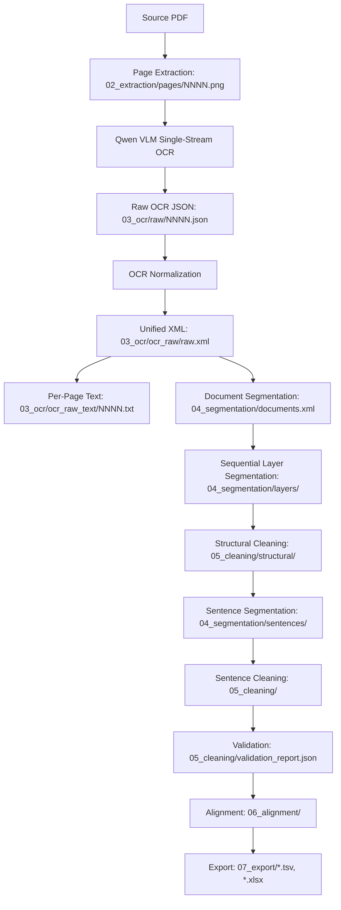

# Xây dựng ngữ liệu song song Hán - Việt

## 1. Giới thiệu

Dự án hướng đến xây dựng ngữ liệu song song Hán - Việt ở cấp câu/đoạn, phục vụ nghiên cứu và ứng dụng trong lĩnh vực Xử lý ngôn ngữ tự nhiên (NLP).

## 2. Quy trình xử lý (Pipeline Architecture)

Quy trình xử lý áp dụng kiến trúc **Single-Stream Qwen VLM OCR & Phân đoạn cấu trúc tuần tự**:



### Các giai đoạn chính:

| Thư mục | Chức năng | Định dạng chính |
|---|---|---|
| `01_sources` | Lưu trữ tài liệu nguồn (`.pdf`, `.html`, ...) | PDF/ảnh gốc |
| `02_extraction` | Trích xuất PDF thành hình ảnh đánh số 4 chữ số | `pages/NNNN.png` |
| `03_ocr` | OCR Single-Stream (Qwen VLM), lưu JSON thô, XML thống nhất và TXT từng trang | `raw/NNNN.json`, `ocr_raw/raw.xml`, `ocr_raw_text/NNNN.txt` |
| `04_segmentation` | Phân đoạn tài liệu, phân đoạn lớp tuần tự (Hán, Âm, Nghĩa, Thơ) và phân đoạn câu | `documents.xml`, `layers/<layer>.xml`, `section_headings.xml`, `sentences/<layer>.xml` |
| `05_cleaning` | Làm sạch cấu trúc (loại bỏ header/footer/chú thích) và chuẩn hóa câu | `structural/<layer>.xml`, `<layer>.xml`, `validation_report.json` |
| `06_alignment` | Dóng hàng câu song song Hán - Phiên âm, Hán - Dịch nghĩa, Hán - Dịch thơ | `<pair>.xml` |
| `07_export` | Xuất dữ liệu dóng hàng tổng hợp và song ngữ | TSV và XLSX |

Các lớp văn bản chuẩn:
- `han`: Hán văn nguyên bản.
- `am`: Phiên âm Hán - Việt.
- `nghia`: Dịch nghĩa tiếng Việt.
- `tho`: Dịch thơ tiếng Việt (tùy chọn theo tác phẩm).

---

## 3. Nguyên Tắc Cốt Lõi: Single-Stream OCR & Segmentation

> **"OCR nhận dạng ký tự. Segmentation hiểu cấu trúc tài liệu."**

1. **OCR 1 lần duy nhất mỗi trang**: Sử dụng mô hình thị giác ngôn ngữ lớn (Qwen VLM) để nhận diện toàn bộ văn bản trên trang sách mà không lọc hay phân tách theo hệ chữ viết (`cjk` / `latin`).
2. **Quy ước đặt tên trang 4 chữ số (4-Digit Zero-Padded)**: Mọi tệp liên quan đến trang đều có định dạng `NNNN` (`0001`, `0015`, `0206`, `9999`).
3. **Nguồn dữ liệu OCR thống nhất**: Toàn bộ dòng nhận dạng được lưu vào `03_ocr/ocr_raw/raw.xml` với ID dòng chuẩn `PNNNN.LNNN`.
4. **Phân đoạn dựa trên tiêu đề mục**: Sử dụng máy trạng thái tuần tự (State Machine) để phân bổ dòng vào các lớp `han`, `am`, `nghia`, `tho`. Tiêu đề mục (`PHIÊN ÂM`, `DỊCH NGHĨA`...) được tách riêng vào `section_headings.xml`.
5. **Bảo tồn dữ liệu thô (Immutability)**: Kết quả OCR gốc (`03_ocr/raw/NNNN.json`) được lưu trữ vĩnh viễn và không bao giờ bị ghi đè hay lọc bỏ phá hủy.

---

## 4. Hướng Dẫn Sử Dụng Nhanh

### 4.1. Cài đặt môi trường
Khuyến nghị dùng môi trường Python 3.11+:
```powershell
pip install -r requirements.txt
```

### 4.2. Chạy toàn bộ pipeline
```powershell
python -m src.pipeline --config configs/CPO_19.json
```

Xem trước các bước thực thi (Dry-run):
```powershell
python -m src.pipeline --config configs/CPO_19.json --dry-run
```

Chạy từng giai đoạn độc lập:
```powershell
# Chạy OCR Single-Stream
python -m src.ocr.ocr --config configs/CPO_19.json --unified

# Chạy Phân đoạn Tài liệu & Lớp
python -m src.segmentation.pipeline --config configs/CPO_19.json

# Làm sạch cấu trúc
python -m src.cleaning.pipeline --work-id CPO_19 --structural-only

# Phân đoạn câu
python -m src.segmentation.sentences --config configs/CPO_19.json

# Kiểm tra tính toàn vẹn
python -m src.validation.validate --config configs/CPO_19.json

# Dóng hàng và xuất bản
python -m src.alignment.align --pair han-am --work-id CPO_19
python -m src.alignment.export --pair han-viet --work-id CPO_19
```

---

## 5. Tài Liệu Kỹ Thuật

- [docs/ocr.md](docs/ocr.md): Kiến trúc OCR Single-Stream Qwen VLM và Tesseract fallback.
- [docs/segmentation_architecture.md](docs/segmentation_architecture.md): Kiến trúc phân đoạn 3 cấp và bộ máy trạng thái tuần tự.
- [docs/migration.md](docs/migration.md): Hướng dẫn chuyển đổi từ Dual-Stream sang Single-Stream.
- [docs/pipeline.md](docs/pipeline.md): Chi tiết các cờ lệnh và cấu hình toàn pipeline.
